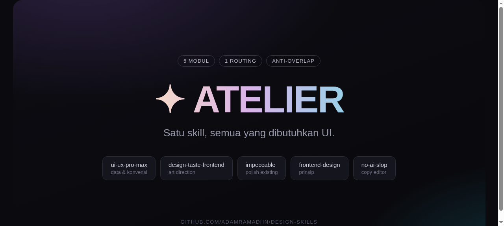

<div align="center">

# ✦ ATELIER

**One skill for everything UI.**
Art direction, polish, design data, aesthetic principles, and copy editing — one entry point, zero overlap.




</div>

---

Let a coding agent build a landing page and it tends to produce the *average* of every page it has
seen: centered headline, three cards with icons, a soft gradient, thin rules. Different open-source
skills attack different slices of that problem — **`atelier` unifies the best of them behind one
routing entry point**, so you install, remember, and invoke a *single* skill instead of many.

The six vendored bodies stay byte-for-byte faithful to their upstream commits (easy to diff and
update), packaged under one root skill with routing that keeps them out of each other's way.

## Modules (6, one routing)

| # | Module | Use it for | Credit / license |
|---|--------|-----------|------------------|
| 1 | `ui-ux-pro-max` | Searchable design conventions: 79 styles, 192 palettes, 74 font pairings, 119 UX guidelines, 22 stacks (fully offline CSV data) | [nextlevelbuilder/ui-ux-pro-max-skill](https://github.com/nextlevelbuilder/ui-ux-pro-max-skill) · MIT |
| 2 | `design-taste-frontend` | Greenfield art direction & building landing/marketing/portfolio pages: directions dealt from a study of 247 gallery sites, strict anti-slop house style, real-browser inspection + screenshot loop | [Leonxlnx/taste-skill](https://github.com/Leonxlnx/taste-skill) · MIT |
| 3 | `impeccable` | Refine / critique / audit / polish **existing** UI: 24 commands (critique, audit, polish, harden, animate, live, …) | [pbakaus/impeccable](https://github.com/pbakaus/impeccable) · Apache-2.0 |
| 4 | `motion-design` | Motion-first UI: timing, easing, choreography, micro-interactions, transitions, loading states, scroll motion, Lottie/GSAP/Framer/CSS springs, brand motion personality | [LottieFiles/motion-design-skill](https://github.com/LottieFiles/motion-design-skill) · MIT |
| 5 | `frontend-design` | Universal aesthetic principles for any fresh UI — typography, motion restraint, UI copywriting; cheap prose, no runtime | [anthropics/skills · frontend-design](https://github.com/anthropics/skills/tree/main/skills/frontend-design) · Apache-2.0 |
| 6 | `no-ai-slop` | Copy & documentation editing: remove or detect AI-slop patterns while preserving the writer's voice | [petergyang/no-ai-slop](https://github.com/petergyang/no-ai-slop) · MIT |

Full provenance (upstream repo + vendored commit per module): [THIRD-PARTY-NOTICES.md](THIRD-PARTY-NOTICES.md).

## How it routes

```
              user request (UI / copy)
                        ↓
              ┌── SKILL.md (atelier) ──┐
              │  text / docs      → no-ai-slop
              │  motion-first     → motion-design
              │  existing UI      → impeccable
              │  new page/landing → design-taste-frontend
              │  data lookup      → ui-ux-pro-max
              │  principles       → frontend-design
              └────────────────────────┘
```

**Anti-overlap guard:** the two creative modules (`design-taste-frontend`, `impeccable`) never
co-own the same artifact in one session — new builds from scratch use taste, incumbent refinement
uses impeccable; the other modules contribute as read-only inputs. Triggers are written the way
users actually speak ("fix this layout", "this looks AI-made"), so the skill fires without anyone
saying the word "design".

## Using a reference URL (style transfer)

Reference a style by URL in your prompt — the skill *measures* it instead of guessing:

> *"Build a coffee landing page, styled like https://termul.dev"*

What happens internally:

1. **Measure, don't eyeball** — `inspect.mjs <url>` (from the taste module) opens the reference in
   a real browser at 1440/768/390, saves screenshots of all three viewports, and reads real tokens:
   actual colors, fonts loaded, type sizes, spacing, radii, shadows, gradients → `.taste-skill/reference/`;
2. **Pin the tokens as `REFERENCE.md`** (project root) — the style's *grammar* (hierarchy, tone,
   rhythm), explicitly not a pixel-clone of the site's content or assets;
3. **Normal routing continues** — greenfield build → taste run with the pinned brief
   (`draw.mjs --keep palette,type` when the reference fixes brand colors/type); existing-UI polish →
   impeccable with `DESIGN.md` seeded from `REFERENCE.md`.

No Chrome/Node around? A screenshot of the reference works too — the agent reads its computed
styles by hand. Sites from the built-in 247-site study also work as a direction:
`node <skill>/scripts/draw.mjs --site <id>`.

## Installation

```bash
sh <(curl -s https://raw.githubusercontent.com/adamramadhn/atelier/main/install.sh)
```

or manually:

```bash
git clone https://github.com/adamramadhn/atelier.git
cp -r atelier/skills/atelier ~/.claude/skills/atelier   # or .agents/skills/, etc.
```

## Updating

Vendored modules move upstream on their own cadence; pull the latest with the same
one-liner (idempotent — re-running replaces `~/.claude/skills/atelier` in place):

```bash
sh <(curl -s https://raw.githubusercontent.com/adamramadhn/atelier/main/install.sh)
```

The installed skill also self-checks: at most once per session (24h throttle), when
`atelier` is triggered the agent runs `scripts/check-update.sh` (one 4s request) and, if a
newer `VERSION` exists on main, asks you update/yes-no before continuing.

The `references/` folder must travel with it — modules load on-demand from there. Slash-invocable
as `/atelier` (Claude Code & agent-standard harnesses); without a slash it auto-triggers on UI work.
To enforce routing at project level in consumer repos, add to `AGENTS.md`/`CLAUDE.md`:

```
Any UI/front-end task (pages, components, styling, layouts, UI copy): read
.claude/skills/atelier/SKILL.md and follow its routing before editing.
```

## Requirements

| Module | Needs |
|---|---|
| `design-taste-frontend` | Node 22+, Chrome/Edge/Chromium; `assets.mjs` needs network (no API key) |
| `impeccable` | Self-contained binary, auto-downloaded to `~/.impeccable/bin/` on first run |
| `ui-ux-pro-max` | Fully offline (bundled CSV data) |
| `frontend-design`, `no-ai-slop`, `motion-design` | No runtime |

## Quick test

After installing, in a fresh Claude Code session: *"build a landing page for a coffee brand"* —
the skill should self-trigger, load `design-taste-frontend`, deal directions, build, and run the
browser screenshot loop (`.taste-skill/` is local working files).

## Contributing

Issues and PRs welcome — routing fixes, new intake flows, upstream module updates, docs. The one
hard rule: `skills/atelier/references/**` is never edited by hand except as a recorded upstream
refresh; see [CONTRIBUTING.md](CONTRIBUTING.md) for the exact vendoring procedure and PR checklist.
All participation follows the [Code of Conduct](CODE_OF_CONDUCT.md).

## License & attribution

This repo is a curated integration. All creative skill content belongs to and is thanks to the
upstream authors in the modules table above; this repository's packaging, routing, and
documentation are MIT licensed (see `LICENSE`). Module bodies keep their upstream licenses —
see [THIRD-PARTY-NOTICES.md](THIRD-PARTY-NOTICES.md).
